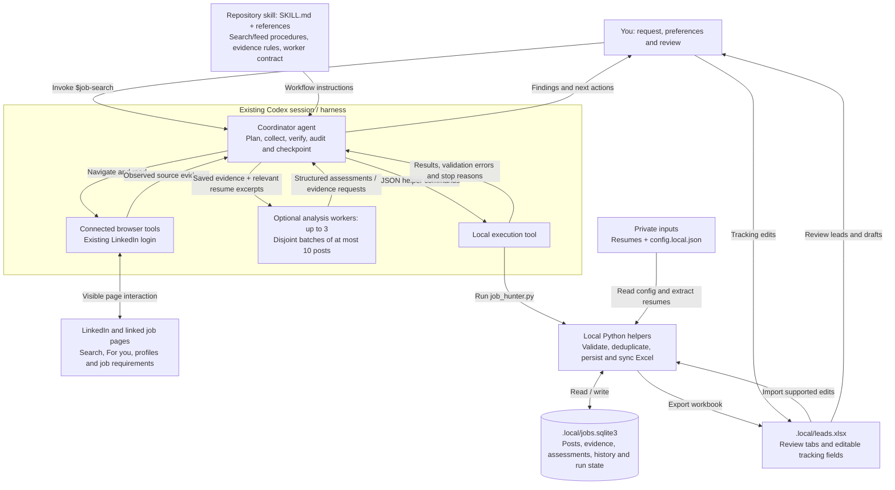
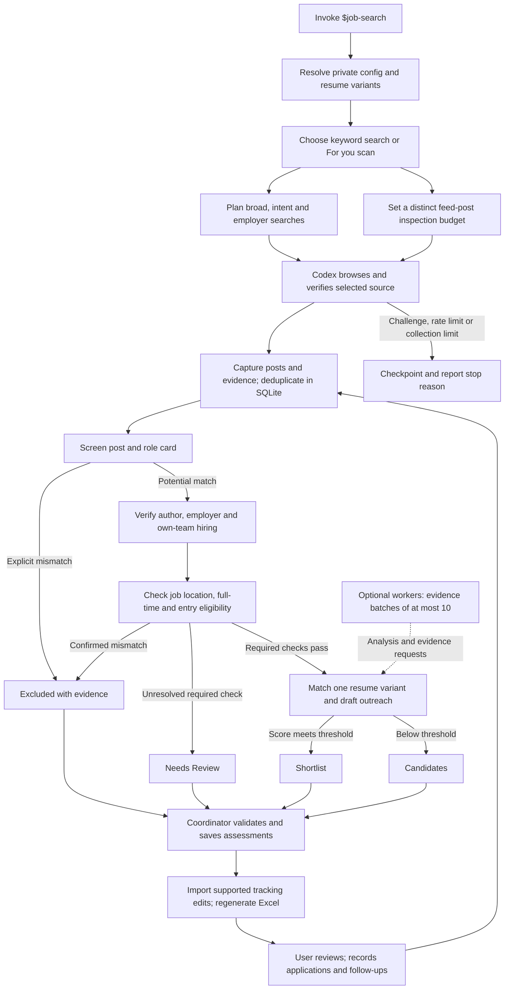

# Hiring Posts Hunter

Find relevant hiring-manager posts, verify who is actually hiring, match opportunities to your resumes, and keep a local application tracker. The default scope is **full-time internship, junior, new-grad, and PhD-entry tech and quant roles**.

This repository delivers one local Codex skill, invoked with `$job-search`, plus Python helpers for persistence and Excel synchronization. Codex performs browser research and reasoning using capabilities available in its session. The helpers validate and store findings; they make no browser, network or model calls.

## Why build this
**With the development of auto job application using personal agents, nowadays job hunting has a more important timing problem nobody tells you about: the same post that gets you an interview at hour one gets you ignored at hour ten, buried under a hundred other applicants who saw it first. "ETL QA" hiring posts go up constantly, scattered across the feed between recruiter spam and unrelated updates — and by the time you manually search, scroll, and actually read through them, the good ones were already old news. Also, it will give you a small advantage if you could reach out to the hiring manager directly.**

The honest fix was showing up first, every single day, without fail. But "check LinkedIn obsessively" isn't a strategy, it's a part-time job I didn't sign up for. So I did what any engineer with a job search and too much stubbornness does: automated the part of the hunt that shouldn't need a human — logging in, searching, reading, filtering, and drafting direct message — and kept the part that does — actually deciding who to reach out to — for myself.

## Inputs and outputs at a glance

| Input | What to provide |
|---|---|
| **Required: resume** | One or more text-readable DOCX/PDF resumes in `../resumes`, or set `resume_dir` to your folder. Matching DOCX/PDF filename stems count as one variant. |
| **Required for live collection: LinkedIn access** | A connected Codex browser with your normal LinkedIn login. |
| Optional: job preferences | Desired role family, seniority, locations, skills and target companies. State these in your Codex request; otherwise the workflow uses its defaults and your resume. |
| Optional: collection settings | Keyword search or Home **For you**, keywords, post count, and search sort/date filters. |
| Optional: eligibility details | Availability date and future sponsorship needs, kept in private `config.local.json`. |

Set reusable preferences in `config.local.json`; give one-run preferences directly to `$job-search`. See [configuration](#configure-your-search) for supported fields and defaults.

| Output file (default path) | What it contains |
|---|---|
| **`.local/leads.xlsx`** | Reviewable **Shortlist, Needs Review, Candidates, Excluded, Applications and Runs** tabs, including source links, match scores, selected resumes, outreach drafts and tracking fields. Created or refreshed when the workbook is synchronized. |
| **`.local/jobs.sqlite3`** | Persistent posts, full captured candidate content, evidence, assessments, resume extracts, deduplication records, application history and run checkpoints. Reused across runs. |

Both outputs stay local and are ignored by Git. Codex also reports collection totals, useful matches, unresolved checks and the stop reason in chat. Outreach messages are drafts for your review.

## Design

A keyword match is only the beginning. A post can advertise an overseas position, come from an external recruiter, describe a senior-only opening, or discuss hiring without offering a job. Even “my team is hiring” can be written by an individual contributor. Useful outreach requires evidence about the **author, employer, team and specific role**.

The implementation separates that research from durable record keeping:

| Responsibility | Owner | Why |
|---|---|---|
| Navigate LinkedIn, inspect profiles and job descriptions | Codex's connected browser, controlled by one coordinator | Reuses the existing browser connection and normal login. |
| Interpret evidence, assess eligibility and match resumes | Codex; optional bounded analysis workers | Keeps contextual judgments with the reasoning agent and preserves unknowns. |
| Validate records, deduplicate, save history and export Excel | Local Python helpers and SQLite | Makes repeated runs, retries and tracking edits predictable. |
| Review drafts and perform outreach or application submission | You | Separates a prepared draft from an action actually taken. |

No custom MCP server, extra installation, or agent framework is required. The skill runs when invoked in Codex; it is not a background crawler or scheduler. If Claude, ask your agent to do some small adaptations.   

## Agent architecture and harness

Codex provides the **harness**: the session that runs the coordinator, exposes browser and local execution tools, and supports optional analysis workers. The repository supplies the skill instructions and tracking helpers that the coordinator uses.



The coordinator is the only agent that browses or invokes database-writing commands. Workers reason over supplied evidence and return results to it; helpers perform local data operations without model calls or browsing. SQLite holds durable state across chats and runs, while Excel is the review surface. External page content remains untrusted evidence, and outreach or application submission remains a user action.

## Workflow



One coordinator owns browsing and database writes. Up to three optional workers analyze distinct batches of at most ten saved records, using relevant resume excerpts. They return assessments or requests for missing evidence; the coordinator obtains evidence and audits conclusions. The workflow can also run sequentially.

The diagram shows decision order. Collection and review can be interleaved in small batches, and a checkpoint workbook can be exported before assessment finishes. Collected pages and spreadsheet cells are treated as data, never instructions.

## Setup

1. Open this repository as your Codex project so the repository-local skill is available.
2. Use **Python 3.12+** with the dependencies in [pyproject.toml](pyproject.toml). If your default `python` is older, substitute a supported interpreter in every command below. An existing supported environment is sufficient.
3. Place resume variants in a local folder outside Git. By default, `../resumes` refers to the sibling folder beside this checkout.
4. Make sure the Codex session has connected browser access, and sign in to LinkedIn normally when prompted. Browser availability depends on the session; this repository does not install or register a browser tool.

Run from the repository root:

```powershell
python --version
python -m pip install "pydantic>=2.11,<3" "openpyxl>=3.1,<4" "pypdf>=5,<7"
if (-not (Test-Path -LiteralPath config.local.json)) {
    Copy-Item -LiteralPath config.example.json -Destination config.local.json
}
python .agents/skills/job-search/scripts/job_hunter.py init
```

`init` creates local storage; it does not start a search. Without browser access, Codex can still review saved evidence, update tracking and synchronize the workbook. Authentication challenges and rate limits stop collection with a checkpoint; resume after resolving access normally.

## Configure your search

Edit **`config.local.json`**, which is ignored by Git. [config.example.json](config.example.json) is the versioned reference. This complete example configures a smaller initial discovery run; employer names are illustrative and do not imply verified vacancies.

```json
{
  "target_count": 30,
  "collection_source": "search",
  "feed_post_count": 50,
  "search_strategy": "hybrid",
  "search_phase": "discovery",
  "sort_by": "relevance",
  "date_posted": "past_month",
  "queries": [
    {"track": "tech", "keywords": "hiring scientist ml"},
    {"track": "quant", "keywords": "hiring quantitative researcher"}
  ],
  "intent_queries": [
    {"track": "tech", "keywords": "\"my team\" hiring \"machine learning\""},
    {"track": "quant", "keywords": "\"my team\" hiring \"quantitative\""}
  ],
  "target_companies": ["Amazon", "Microsoft"],
  "author_titles": ["manager", "director", "head", "founder"],
  "author_max_age_days": 30,
  "max_inspected": 500,
  "max_loading_actions": 50,
  "max_minutes": 30,
  "no_progress_limit": 3,
  "shortlist_threshold": 60,
  "resume_dir": "../resumes",
  "available_from": null,
  "future_sponsorship": null,
  "filters": {
    "location": "enforce",
    "title": "enforce",
    "skills": "flag",
    "start_date": "flag",
    "sponsorship": "flag"
  }
}
```

### Configuration precedence

For `start-run`, settings come from `config.example.json`, then `config.local.json`, then the command's `config` overrides. Ask Codex for a one-run change in your prompt; it can pass that as a run override without editing defaults. Each run saves its effective configuration and resume extracts.

Private config replaces top-level values, including whole query lists and the whole `filters` object. If you change `filters` in the private file, keep all five entries above. Run-level filter overrides merge into the effective filter map.

**Set phase, sort and date together.** Changing only `search_phase` does not replace explicit sort/date values inherited from the example configuration. For initial discovery use `discovery`, `relevance`, `past_month`; for regular monitoring use `monitoring`, `date_posted`, `past_week`.

### Search controls

| Setting | Default | Meaning / supported values |
|---|---|---|
| `collection_source` | `search` | `search` for keyword research or `for_you` for the recommended Home feed. |
| `feed_post_count` | `50` | Distinct feed posts to inspect, from 1 to 500; applies only to `for_you`. |
| `search_strategy` | `hybrid` | `broad`, `intent`, `employer`, or `hybrid` to combine the three. |
| `search_phase` | `monitoring` | `discovery` for initial research or `monitoring` for repeat searches; does not schedule runs. |
| `queries` | Alternating tech/quant phrases | Nonempty list of `{track, keywords}` records. Track is `tech` or `quant`; used by broad and employer searches. |
| `intent_queries` | Domain-specific team-hiring phrases | Same structure as `queries`; used by intent search. For a single-track hybrid run, update both query lists. |
| `target_companies` | `[]` | Employer names for author-company or People-search scoping. If empty, Codex selects a justified scope or explicitly skips that part of the search. |
| `author_titles` | Manager, director, head, founder | Hints where title filtering is available; not proof of management or hiring authority. |
| `sort_by` | `date_posted` | `date_posted` corresponds to Latest; `relevance` to Top Match. Codex verifies the selected UI state. |
| `date_posted` | `past_week` | `past_24_hours`, `past_week`, `past_month`, `all_time`. Unavailable UI options are reported. |
| `author_max_age_days` | `30` | Maximum age for reused author evidence. Changed employer or contradictory evidence also triggers revalidation. |

Broad queries preserve coverage when managers do not use a particular phrase. Intent queries add ownership language while retaining a domain anchor: `scientist` alone can attract unrelated wet-lab roles. Employer targeting narrows who is posting, but a US company can still have overseas employees and internal recruiters. **Author company** means employees; **From company** means company-page posts. People search can add US location and current company where those controls are available.

Do not add every desired skill to one query or exclude every occurrence of “senior.” A senior manager can advertise junior positions, and a post can contain several roles. Codex splits distinct roles and evaluates their requirements separately.

### Collection limits

| Setting | Default | What it bounds |
|---|---:|---|
| `target_count` | 100 | New unique candidate posts across the run, **not** qualified opportunities. |
| `max_inspected` | 500 | Distinct inspected post IDs in the run. |
| `max_loading_actions` | 50 | Additional result-loading actions across queries. |
| `max_minutes` | 30 | Active collection time reported through checkpoints; not total analysis/export duration. |
| `no_progress_limit` | 3 | Consecutive load/ingestion checkpoints without new posts. |

These are global run limits, not fresh allowances for every query. Exhausted results, access challenges or a reached limit can stop a run below its target. The final report states the actual count and stop reason. Helpers enforce recorded counters; the coordinator must report loading actions and elapsed collection time accurately.

### Resume and eligibility settings

| Setting | How to configure it |
|---|---|
| `resume_dir` | Folder containing DOCX/PDF files. Relative paths resolve from the command's working directory, so run from the repository root. In Windows JSON, use forward slashes or escaped backslashes. |
| `available_from` | Your start date as `YYYY-MM-DD`, or `null` if unspecified. Store the actual date only in private config. |
| `future_sponsorship` | `true`, `false`, or `null` for unspecified. Keep your answer private. |
| `shortlist_threshold` | Integer score from 0 to 100; default 60. A score alone cannot bypass missing verification. |

Give matching DOCX/PDF versions the **same filename stem**, such as `research.docx` and `research.pdf`; they become one variant and DOCX text is preferred. Different stems are separate variants. Extraction reads files directly in the configured directory, not nested folders. It does not perform OCR, so scanned PDFs may need a text-based version. Assessments select one variant and retain source-specific quotes rather than combining conflicting claims across resumes.

The `filters` values control how Codex's semantic checks affect routing:

| Mode | Effect |
|---|---|
| `enforce` | A confirmed mismatch excludes the role; an unknown check sends it to Needs Review. |
| `flag` | Failed or unknown checks become advisory flags without changing the bucket. |
| `off` | That optional check does not affect routing or generate a flag automatically. |

By default, job `location` and `title` are enforced; `skills`, `start_date` and `sponsorship` are advisory. Keep start date and sponsorship in `flag` mode for the intended workflow. These fields are **modes, not lists of criteria**. State specific cities, role families or desired skills in your Codex request; the coordinator records the criteria and assesses evidence. Resume matching supplies additional context.

Seven core checks always remain required: active hiring, full-time employment, junior/PhD-entry suitability, the author's personal US location, management responsibility, current employer affiliation and own-team hiring. Turning an optional filter off does not disable these checks. Author location, job location and company headquarters are separate facts. A PhD can satisfy a qualifying route with different experience requirements from a master's route.

## Run it in Codex

| Task | Example prompt |
|---|---|
| Initial discovery | `$job-search Find 30 new candidates using hybrid search, Top Match and Past month. Prioritize applied ML research and quantitative research.` |
| Repeat monitoring | `$job-search Find 100 new tech and quant posts, Latest and Past week. Reuse fresh author evidence and update my tracker.` |
| Scan recommendations | `$job-search Inspect 50 distinct posts in LinkedIn Home For you, collect relevant hiring posts, verify authors and update my tracker.` |
| Narrow criteria | `$job-search Focus on full-time PhD-entry research roles in New York or Seattle. Treat Python and reinforcement learning as preferred skills.` |
| Resume work | `$job-search Inspect saved run progress and continue pending reviews. Keep existing application history.` |
| Review candidates | `$job-search Review Needs Review records, identify missing evidence, and explain each decision.` |
| Prepare an application | `$job-search Review this role's requirements, select the best resume variant, and draft application answers.` |
| Record activity | `$job-search Record that I applied to lead <lead_id> on <date>, and set the next action and follow-up date.` |
| Sync Excel edits | `$job-search Import my supported tracking edits from the workbook and regenerate it.` |

The workflow drafts 70–120 word LinkedIn messages and can prepare application answers. It does not send messages, request connections, upload resumes or submit applications. Application history records actual reported or observed actions. Follow-up dates are tracking fields, not scheduled reminders.

### Scan the Home / For you feed

Recommendations can surface hiring posts outside your keyword queries. Use the **same skill and database** so a post discovered in search and again in the feed remains one tracked source. Set `collection_source` to `for_you` and `feed_post_count` to the desired inspection count, or supply both in your request. Search remains the default; hybrid refers to combining search approaches, not automatically scanning the feed.

The feed count means **all distinct post cards inspected**, including unrelated posts and sponsored cards, not a target number of hiring matches. Sponsored cards are recorded as skipped; people suggestions, sidebar widgets and nested reposts are not extra posts. Repeated cards count once within a run. Previously seen posts count toward a new day's inspection budget without becoming new leads. Codex preserves the displayed recommendation ordering; keyword search filters, `sort_by`, `date_posted` and `target_count` do not apply to this source. Recommendation today does not imply that a vacancy is recent or still open.

The coordinator uses `ingest-feed` to save batches of up to ten screening decisions. Minimal IDs and reasons are retained for skipped posts; relevant candidates retain expanded content and source evidence. New non-hiring posts still count as progress. Collection stops at X inspected posts or an earlier inspection/load/time/stall/access limit. The same US-author, manager, affiliation, own-team and role eligibility checks then apply. For both search and feed in one session, create separate bounded runs against the same tracker.

### Schedule it later

Scheduling is optional and managed through Codex's native automation capability. **No schedule is installed by this repository or by adding feed mode.** When ready, ask:

> Schedule $job-search in this repository to inspect 50 distinct Home For you posts daily at 9 AM America/New_York, verify relevant hiring posts, and update the existing local tracker.

The [feed workflow](.agents/skills/job-search/references/feed.md) includes a reusable task prompt. Keep the existing checkout and `.local` database available between runs. Use an ongoing-chat task unless you want a separate standalone run; avoid overlapping collectors. Local-file tasks require the computer on and app running according to the [official scheduling documentation](https://learn.chatgpt.com/docs/automations?surface=app). Browser access and LinkedIn login must also be available in the scheduled session. If either is missing, the run checkpoints and reports incomplete collection. A manual smoke test does not establish unattended browser access; validate the first scheduled execution separately.

## Matching and review

| Score component | Maximum |
|---|---:|
| Role alignment | 30 |
| Skills alignment | 30 |
| Experience alignment | 25 |
| Education and seniority fit | 15 |
| **Total** | **100** |

Scores need explanations grounded in the selected resume and saved opportunity evidence; they are not interview probabilities. All required checks must pass before a role can reach Shortlist. A confirmed required mismatch goes to Excluded; missing required evidence goes to Needs Review. Verified roles below the threshold remain Candidates. Python validates structure and provenance references; it cannot establish whether a quotation truly supports Codex's interpretation.

## Tracking, deduplication and privacy

SQLite persists posts, evidence, assessments, run progress and application history. Canonical post IDs are deduplicated across queries and runs, with author/content fingerprints as fallback. Edited posts retain previous versions and require reassessment. Confirmed reposts can be grouped by company/requisition while preserving sources; uncertain similarities are flagged rather than merged. Distinct roles in one post remain separate.

The default workbook is **`.local/leads.xlsx`**:

| Tab | Contents |
|---|---|
| Shortlist | Verified roles meeting the score threshold and still eligible for fresh review. |
| Needs Review | Roles with unresolved required evidence. |
| Candidates | Master view of assessed leads plus pending posts; rows can also appear in a review tab. |
| Excluded | Assessed roles with confirmed required mismatches. |
| Applications | Recorded application/contact/activity events. |
| Runs | Collection source, inspection/candidate totals, feed dispositions, counters and stop reasons. |

Edit only **`status`, `selected_resume`, `application_date`, `next_action`, `follow_up_date`, `notes`**. Preserve stable IDs. Supported statuses are `new`, `reviewing`, `shortlisted`, `saved`, `contacted`, `applied`, `interviewing`, `offer`, `rejected`, `withdrawn`, `dismissed`, and `closed`. Pending post rows have no lead ID yet and are not editable lead records.

Ask Codex to synchronize after editing. It imports supported edits before regeneration and reports conflicts across workbook tabs or between Excel and SQLite. Previously contacted, applied, dismissed or closed leads remain in history and do not return as fresh leads. Full source content remains local even when an Excel cell is truncated. Exports use atomic replacement; if Excel locks the destination, the helper writes a timestamped fallback and reports its path.

| Location | Purpose | Git |
|---|---|---|
| `.agents/skills/job-search/` | Skill, references and local helpers | Tracked |
| `config.example.json`, `tests/`, documentation | Example settings and synthetic validation | Tracked |
| `config.local.json` | Preferences and eligibility details | Ignored |
| `.local/jobs.sqlite3` | Tracking database and saved evidence | Ignored |
| `.local/` | Workbooks, audit JSON, excerpts and helper inputs | Ignored |
| `../resumes/` or configured external folder | Resume originals | Outside this repository |

The default data directory is inside the checkout but excluded from Git. Keep resume originals outside the repository and do not force-add private files. Git ignore is not encryption or backup; retain a private backup of the database and workbook edits you need to preserve.

## Local helper interface

Most users can ask Codex to operate the helper. For direct use, commands accept structured JSON and return JSON:

```powershell
python .agents/skills/job-search/scripts/job_hunter.py COMMAND --input .local/request.json --data-dir .local
```

Use the same data directory across related runs so deduplication and history persist. `--data-dir` changes storage, not the location of repository configuration. Keep private inputs out of tracked example files.

To preview settings without starting collection:

```powershell
$jobHunterConfig = Get-Content -LiteralPath config.local.json -Raw | ConvertFrom-Json
@{ config = $jobHunterConfig } | ConvertTo-Json -Depth 10 | Set-Content -LiteralPath .local/search-plan-input.json -Encoding utf8
python .agents/skills/job-search/scripts/job_hunter.py search-plan --input .local/search-plan-input.json
```

Run `init` first so `.local` exists. Standalone `search-plan` uses its supplied config and built-in defaults; it does not automatically load `config.local.json`. `start-run` loads repository/private settings and returns the effective plan, but also extracts resumes and creates a run record. Neither command performs browser collection.

See the [JSON command reference](.agents/skills/job-search/references/commands.md) for ingestion, evidence, assessments, author cache, status, activity and comparison operations.

## Compare search approaches

Declare exact queries, scopes and shared limits before collecting:

> $job-search Compare broad, intent and employer searches using the first 10 unique posts, at most 3 profile checks and 2 JD checks per approach. Use tech roles, Top Match and Past month. Save the protocol and report overlap, unknowns and unused budget.

Comparison commands preserve the protocol and per-approach audit, reject conflicting retries, and distinguish promising posts, verified US own-team managers and eligible openings. Cached evidence consumes the same verification allowance. Equal action caps do not imply equal elapsed time, and eligibility is separate from resume-scored shortlisting.

In the [November 10 pilot](SEARCH_COMPARISON.md), broad / phrase / employer searches found **3 / 0 / 1** verified US hiring managers and **1 / 0 / 1** eligible posts. The eligible post was shared across two approaches. Targeting did not outperform the broad baseline in that small sample, so the implementation keeps broad discovery alongside configurable targeting. Refined domain-specific intent presets, quant coverage and US-filtered People search still need separate live comparisons.

## Validation and further reading

```powershell
python -m unittest discover -s tests -v
```

The current suite has 44 passing tests covering local data integrity, routing, history, workbook edits, comparison budgets, author-cache behavior and bounded feed scanning. Tests use synthetic data and temporary databases. [VALIDATION.md](VALIDATION.md) distinguishes automated checks from live validation and records limitations. Existing browser access does not remove LinkedIn's restrictions or access controls; keep research bounded and stop on challenges.

- [Skill entry point](.agents/skills/job-search/SKILL.md): coordinator workflow and delegation.
- [Discovery strategy](.agents/skills/job-search/references/discovery.md): search selection, screening and comparison protocol.
- [Browser workflow](.agents/skills/job-search/references/browser.md): capture, pagination, checkpoints and verification.
- [For you feed workflow](.agents/skills/job-search/references/feed.md): inspection counting, feed capture and a reusable scheduling prompt.
- [Assessment contract](.agents/skills/job-search/references/assessment.md): evidence checks, scoring and drafts.
- [Helper API](.agents/skills/job-search/references/commands.md): structured local commands.
